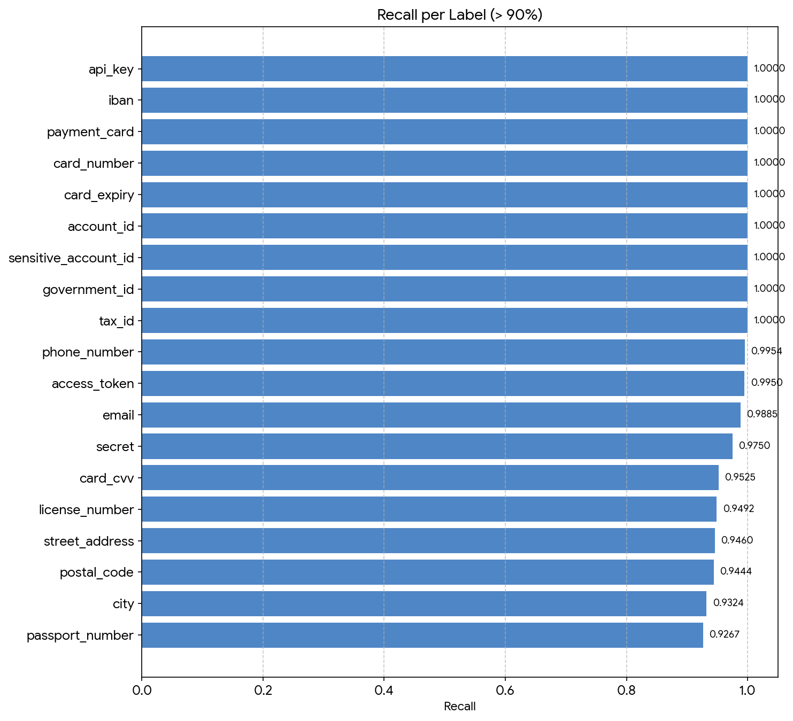
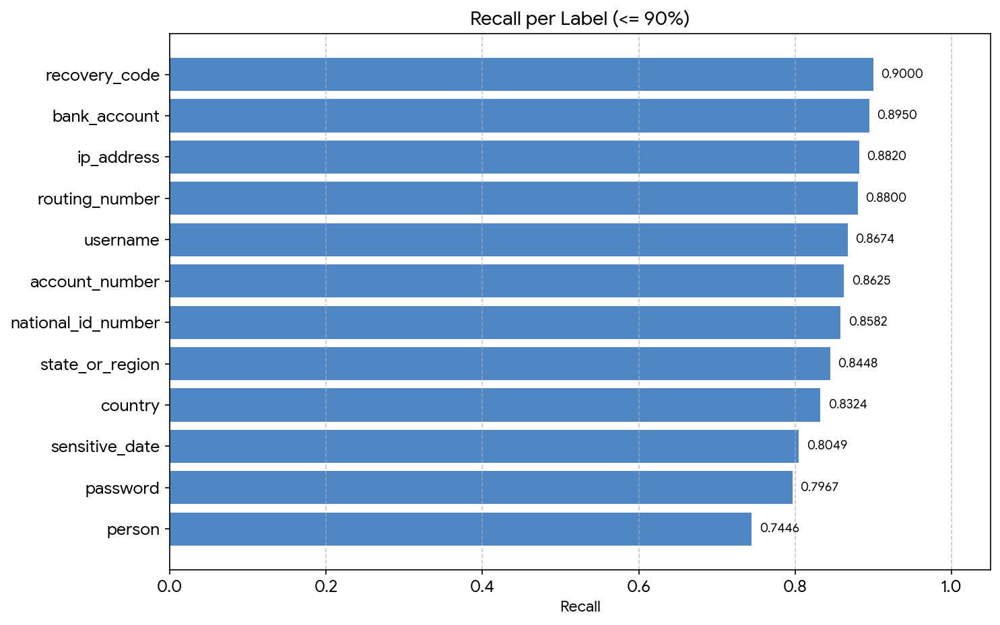
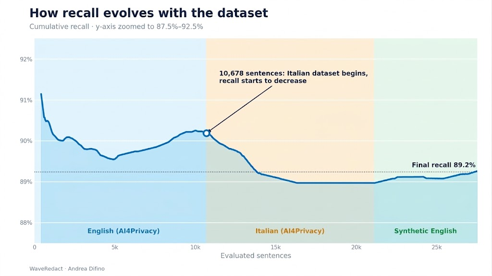

# WaveRedact: Advanced Pipeline Benchmark Report

**Date:** October 2026

**Pipeline:** Regex + GLiNER + LLM (Qwen2.5-7B-Instruct-Q4_K_M GGUF)

**Objective:** Large-scale evaluation of PII (Personally Identifiable Information) extraction performance on bilingual texts (English and Italian).

## 1. Dataset Composition

The benchmark was executed on a massive, balanced dataset, cleaned of structural artifacts (JSON/XML) to best simulate the conversational output of an audio transcriber (e.g., Whisper).

* **Italian (AI4Privacy):** 10,432 sentences

* **English (AI4Privacy):** 10,678 sentences

* **English (Synthetic - Faker):** 6,400 sentences

* **Total Sentences Evaluated:** 27,510

## 2. Global Token-Level Metrics

The pipeline processed the entire dataset, yielding the following global metrics on sensitive tokens:

| Metric | Value | 
| ----- | ----- | 
| **True Positives (TP)** | 140,692 | 
| **False Positives (FP)** | 42,674 | 
| **False Negatives (FN)** | 16,970 | 
| **Recall** | **0.8924** | 
| **Precision** | **0.7673** | 
| **F1-Score** | **0.8251** | 

### Trade-off Analysis: Recall vs. Precision

In a Data Privacy context, a False Negative (letting a sensitive data point leak) represents a data breach, whereas a False Positive (censoring an innocuous word) is merely a reading inconvenience.

The pipeline was intentionally calibrated to be "aggressive". The Precision at `0.7673` is not a flaw, but the result of this design choice: the 42,674 False Positives spread across 27,510 sentences equate to **an average of only 1.5 extra innocuous words censored per sentence**. An acceptable cost to keep Recall near the 90% threshold.

## 3. Class-Wise Metrics

By analyzing individual labels, a clear picture emerges of the architecture's strengths and its current vulnerabilities.

**The Excellences (Recall > 95%):**
The combined use of Regex and LLM makes the pipeline infallible on rigid patterns and international formats.

* `email`: 0.9885

* `phone_number`: 0.9954

* `api_key`, `iban`, `card_number`: 1.0000

The bar chart below shows all the labels that got a recall greater than 90%.

**The Weaknesses (Bottlenecks):**

* `person` (Recall: 0.7446, FN: 3,685).
* `password` (Recall: 0.7967, FN: 634).
* `sensitive_date` (Recall: 0.8049, FN: 1,832).
* `country` (Recall: 0.8324, FN: 1,091).
* `state_or_region` (Recall: 0.8448, FN: 1,068).
* `national_id_number` (Recall: 0.8582, FN: 3,284).
* `account_number` (Recall: 0.8625, FN: 55).
* `username` (Recall: 0.8674, FN: 1,382).
* `routing_number` (Recall: 0.8800, FN: 48).
* `ip_address` (Recall: 0.8820, FN: 857).
* `bank_account` (Recall: 0.8950, FN: 42).
* `recovery_code` (Recall: 0.9000, FN: 40).
  
The bar chart below shows all the labels that got a recall lower or equal to 90%.

## 4. Issues Encountered and Analysis

The Recall trend during the test showed a clear dip as soon as the dataset transitioned from English to Italian sentences. The main issues isolated in this benchmark are:

### The "Cross-Lingual Penalty" (Linguistic Friction)

The LLM is instructed with a *System Prompt* entirely in English, but it must analyze Italian text and map entities to English labels. This double linguistic leap creates a "cognitive overload" in a compact model (7B parameters), pushing it towards omission (Silent Ignore) to avoid errors, drastically lowering the Recall on Italian proper nouns and regions.